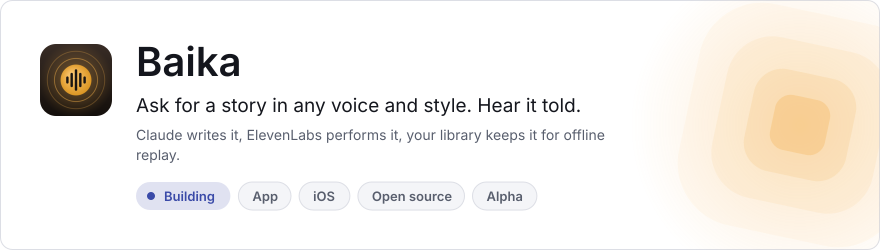
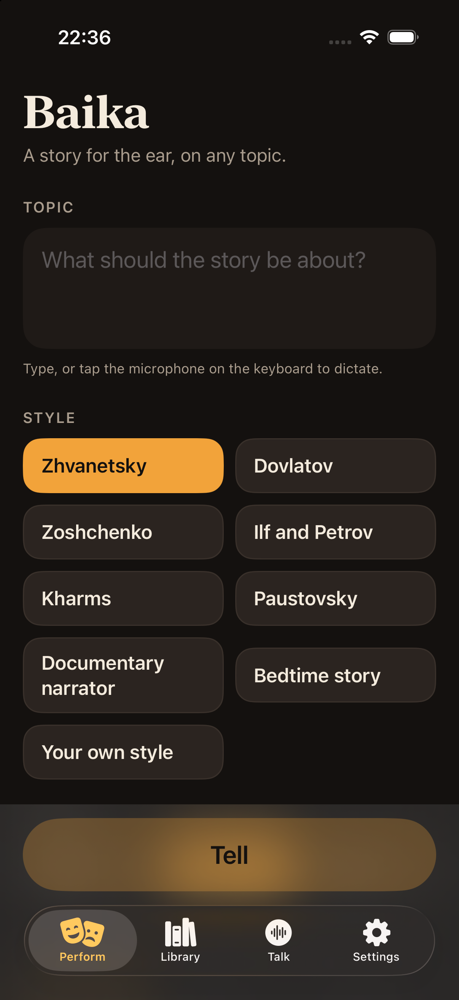
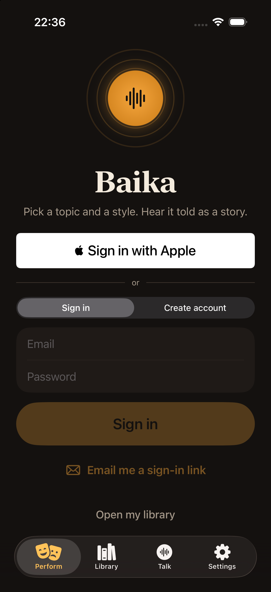
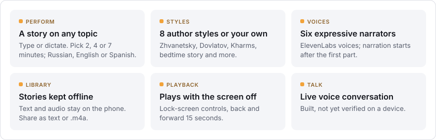
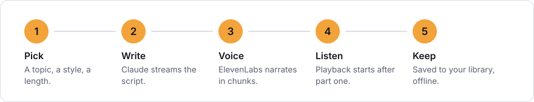

<!-- Pictures: docs/readme/spec.json, drawn by readme-kit. Do not edit the SVGs by hand. -->
<picture><source media="(prefers-color-scheme: dark)" srcset="docs/readme/hero-dark.svg"></picture>

**Try "the history of the Canary Islands, the way Zhvanetsky would tell it", and listen.**
Baika is an iPhone app in alpha. Perform (a narrated story) and the Library work today; Talk is built but unverified on a device.

[Docs](docs/ARCHITECTURE.md) · [Roadmap](docs/ROADMAP.md) · [Release steps](docs/RELEASE.md)

<p align="center">
  
  
</p>

## What it does

<picture><source media="(prefers-color-scheme: dark)" srcset="docs/readme/highlights-dark.svg"></picture>

- **Your own style.** Besides the 8 presets, type a style of your own.
- **Shortcuts.** Tell a story, replay the last one, or continue it.
- **Backup voice.** An OpenAI voice takes over when the ElevenLabs provider is not configured.
- **No voice cloning.** A style imitates an author's manner in the text; voices are ElevenLabs library voices.
- **Film is later.** Generated video is on the [roadmap](docs/ROADMAP.md).

## How it works

<picture><source media="(prefers-color-scheme: dark)" srcset="docs/readme/steps-dark.svg"></picture>

[`docs/ARCHITECTURE.md`](docs/ARCHITECTURE.md) describes the flow and the hub contract.

## Quick start

```bash
git clone https://github.com/zaitsew/baika && cd baika
brew install xcodegen
./check.sh                      # engine tests + Xcode project + simulator build
open Baika.xcodeproj            # run on an iPhone simulator
```

Sign in with a Fabrique Accounts account (Apple, email or link). The app ships its hub URL and publishable key; there is nothing to configure.

## Status

Alpha. Perform and the Library work. Talk (live voice conversation) is built and unverified on a device. Film (generated video) is later. See [`docs/ROADMAP.md`](docs/ROADMAP.md).

<details>
<summary>Code layout and checks</summary>

| path | what |
|---|---|
| `Sources/BaikaKit` | pure logic: styles, voices, prompt, sanitizer, chunker, audio cache, fallback decision |
| `Sources/BaikaAccounts` | the hub bridge: script stream, `HubAudioClient` |
| `App/` | SwiftUI app: Perform, Library, Talk, Settings |

`./check.sh` is the gate (pre-push hook; no CI on push). `./check.sh quick` runs the package tests only. `./check.sh usage` prints usage counters.

</details>

## Docs

| document | what is in it |
|---|---|
| [`docs/ARCHITECTURE.md`](docs/ARCHITECTURE.md) | how a story flows; the hub contract |
| [`docs/ROADMAP.md`](docs/ROADMAP.md) | Talk, Perform, Film: what is next |
| [`docs/RELEASE.md`](docs/RELEASE.md) | TestFlight steps and the store checklist |
| [`docs/APP-STORE.md`](docs/APP-STORE.md) | store listing and review notes |
| [`CONTRIBUTING.md`](CONTRIBUTING.md) | how to contribute |

## Licence

See [`LICENSE`](LICENSE).

<sub>Built by <a href="https://github.com/zaitsew">zaitsew</a> with a fleet of AI agents. The cake is a lie. The story is told in good faith.</sub>
